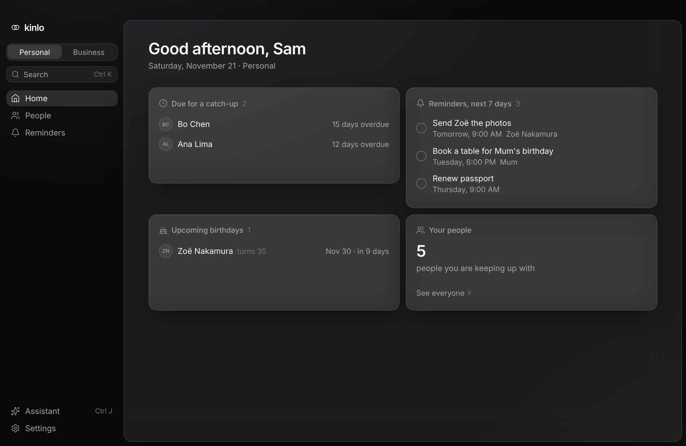
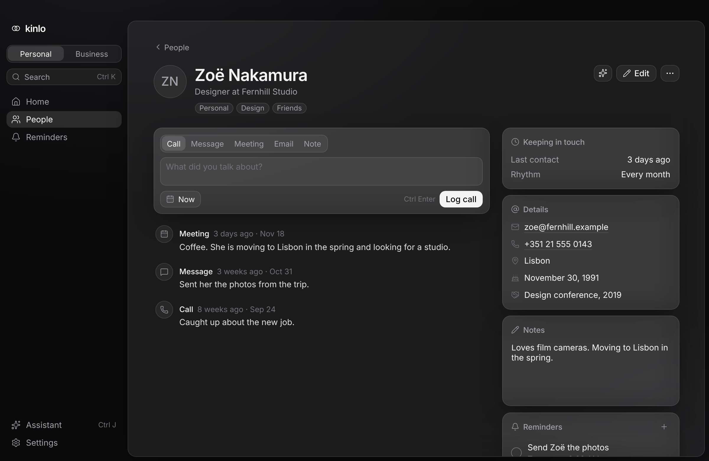
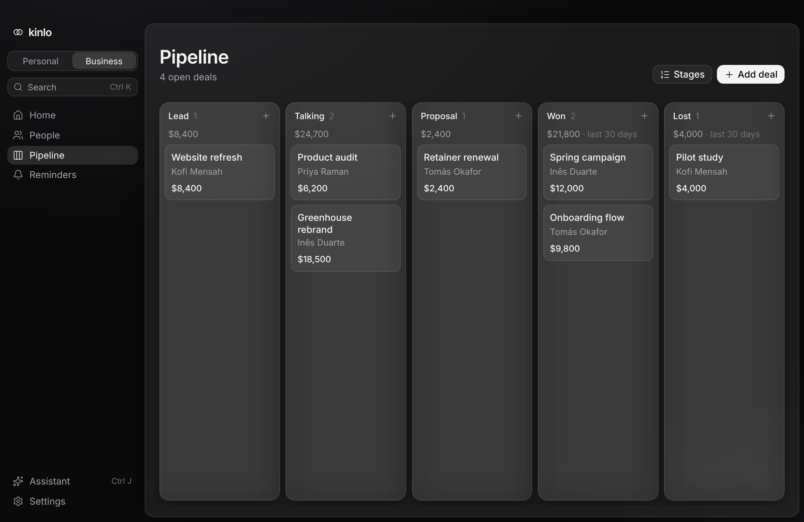
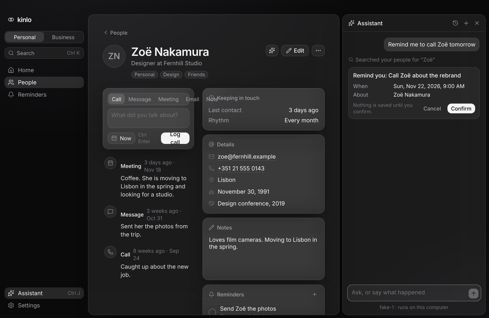
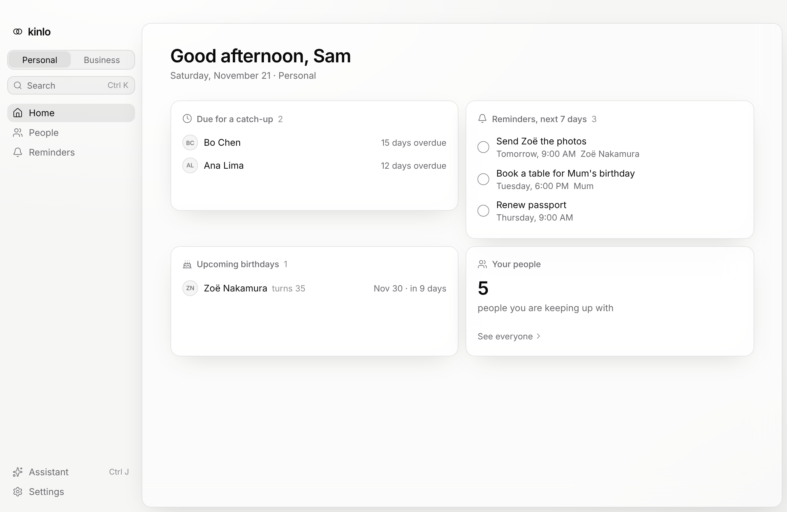

<p align="center">
  
</p>

<h1 align="center">kinlo</h1>

<p align="center"><strong>Remember your people.</strong></p>

<p align="center">
  A free, open-source personal CRM for your desktop.<br>
  No account, no server, no tracking. Everything stays on your computer.
</p>

<p align="center">
  <a href="https://kinlo-website.vercel.app"><strong>Website</strong></a> ·
  <a href="https://github.com/mkhanani/kinlo/releases/latest"><strong>Download</strong></a>
</p>



kinlo keeps track of the people in your life and the people you work with: who they are, when you last spoke, what was said, and what you meant to do next. It runs on Windows, macOS and Linux.

## What it does

- **People.** Notes, how you met, birthdays, tags, and a timeline of every call, message, meeting and email.
- **Keeping in touch.** Say how often you want to be in touch with someone, and kinlo tells you when it has been too long.
- **Reminders.** One-off or repeating, about a person or not, with notifications on your desktop and snooze.
- **Two sides.** Personal and Business are kept apart, with a switch between them. Use one, or both.
- **Pipeline.** On the business side, a simple board of deals you drag from stage to stage. The stages are yours to rename.
- **Search and the command palette.** `Ctrl` or `Cmd` + `K` finds anyone and jumps anywhere.
- **An optional assistant.** Connect your own AI model and ask about your people, or tell it what happened in a sentence and let it file it. Every change is shown to you first.
- **Your data is yours.** Export everything as JSON, people as CSV, and import contacts from Google, Outlook and others.

| | |
|---|---|
|  |  |
|  |  |

## Install

Download the file for your computer from the [latest release](https://github.com/mkhanani/kinlo/releases/latest).

| System | File |
|---|---|
| Windows | `kinlo_x.y.z_x64-setup.exe` |
| macOS, Apple Silicon (M1 and later) | `kinlo_x.y.z_aarch64.dmg` |
| macOS, Intel | `kinlo_x.y.z_x64.dmg` |
| Linux | `.AppImage`, `.deb` or `.rpm` |

kinlo is not code-signed. Signing costs money every year, and this is a free project. Your computer will warn you the first time you open it. That is expected, and here is how to get past it.

### Windows: "Windows protected your PC"

1. Click **More info**.
2. Click **Run anyway**.

### macOS: "Apple could not verify kinlo is free of malware"

1. Open the `.dmg` and drag kinlo to Applications.
2. Open kinlo. macOS refuses and shows the warning. Click **Done**.
3. Open **System Settings**, then **Privacy & Security**, and scroll down to the message about kinlo.
4. Click **Open Anyway**, then confirm.

You only do this once. On older versions of macOS you can instead right-click kinlo in Applications and choose **Open**.

If macOS says kinlo "is damaged and can't be opened", it is not damaged; that is the same check in a stricter mood. Run this in Terminal and open it again:

```bash
xattr -cr /Applications/kinlo.app
```

### Linux

Install the `.deb` or `.rpm` with your package manager, or make the `.AppImage` executable and run it.

To use the assistant with an API key, a keyring service such as GNOME Keyring or KWallet needs to be running, which it is on most desktops. Everything else works without one.

## Privacy

- Your data is one SQLite file on your computer. Settings shows where it is.
- There is no account, no kinlo server, no analytics and no crash reporting.
- kinlo goes online in two cases only, and both start with you:
  - If you connect an AI model, your questions go to the provider you chose, when you ask something.
  - If you press **Check for updates**, kinlo asks GitHub, where it is published, whether there is a newer version. Nothing about you or your data is sent.
- API keys are stored in your operating system's keychain, never in kinlo's files.

More detail: [where data lives](docs/DATA.md) and [what the assistant sends](docs/ASSISTANT.md).

## The assistant

It is optional and off until you set it up in **Settings → Assistant**. Bring your own key for Anthropic, OpenAI or Google, point it at any service that works like OpenAI's, or run a model on your own computer with [Ollama](https://ollama.com), in which case nothing leaves your machine.

It can look things up by itself. It cannot change anything by itself: every addition or edit appears as a card, and nothing is saved until you confirm it.

## Updating

Open **Settings → Updates** and press **Check for updates**. If there is a newer version, press **Update and restart**: kinlo downloads it, checks that it really comes from this project, installs it and opens again.

- kinlo never looks for updates by itself. It goes online for this only when you press the button.
- Your data is not touched: it lives in its own folder, not inside the app.
- On Linux, a kinlo installed from the `.deb` or `.rpm` asks for your password to install the update. The `.AppImage` replaces itself.
- Versions before 0.2.0 do not have the button. To move from one of those, download the newer version from the [latest release](https://github.com/mkhanani/kinlo/releases/latest), quit kinlo completely (**Settings → Quit kinlo**, or the kinlo icon in the system tray) and run the installer. That is needed once.

You can always update by hand that same way instead.

## Backing up

Close kinlo and copy the database file that **Settings → Your data** points to. Putting that file back restores everything. The JSON export is a readable copy of all your data; this version cannot import it again.

## Not in this version

Sync between devices, a phone app, email or calendar integration, shared use by more than one person, updates that install without being asked, and code signing.

## Building from source

You need [Node.js](https://nodejs.org) 22 or later, [Rust](https://rustup.rs) 1.90 or later, and the [system packages Tauri asks for](https://tauri.app/start/prerequisites/).

```bash
git clone https://github.com/mkhanani/kinlo.git
cd kinlo
npm install
```

```bash
npm run app:dev
```

That runs the development flavor, "kinlo dev", which keeps its data apart from an installed kinlo.

```bash
npm run check
```

That runs the type check, the tests and the Rust checks. To build installers for your own system:

```bash
npm run app:build
```

kinlo is built with [Tauri 2](https://tauri.app), React, TypeScript, Tailwind and SQLite. How changes move from a branch to a release is in [docs/ENVIRONMENTS.md](docs/ENVIRONMENTS.md).

## License

[MIT](LICENSE)
